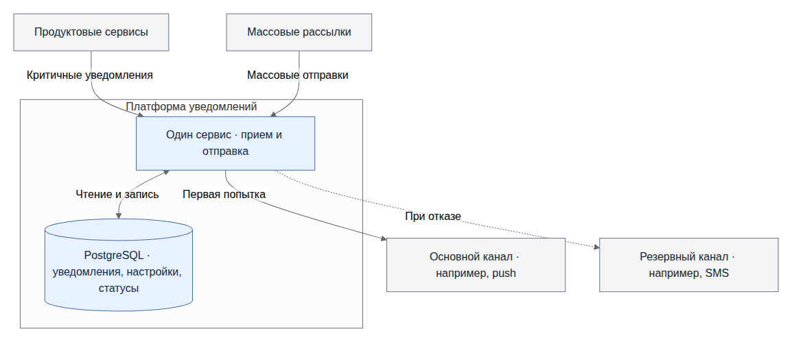
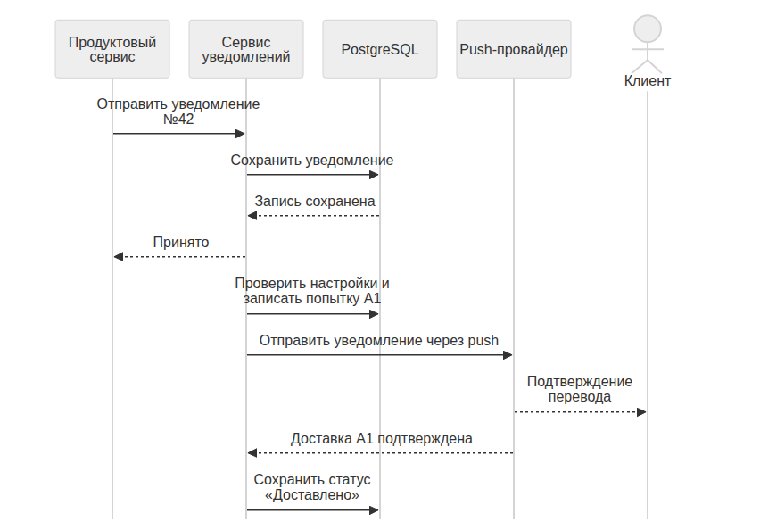
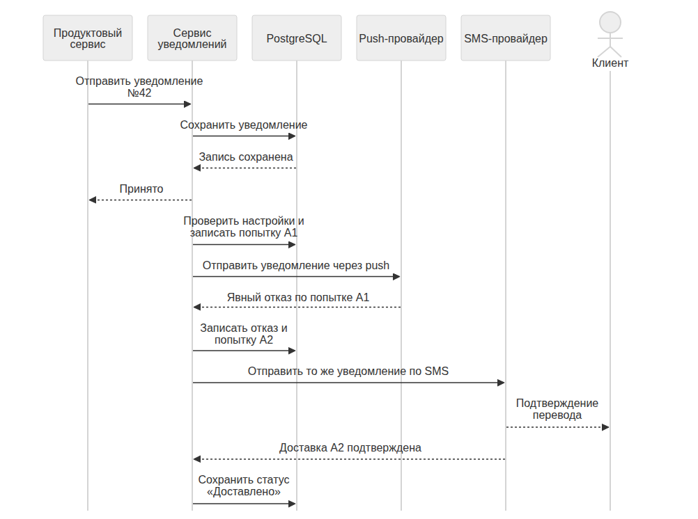
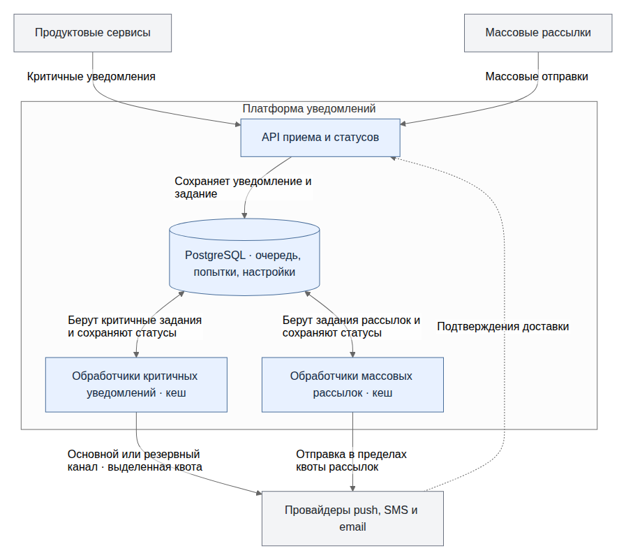
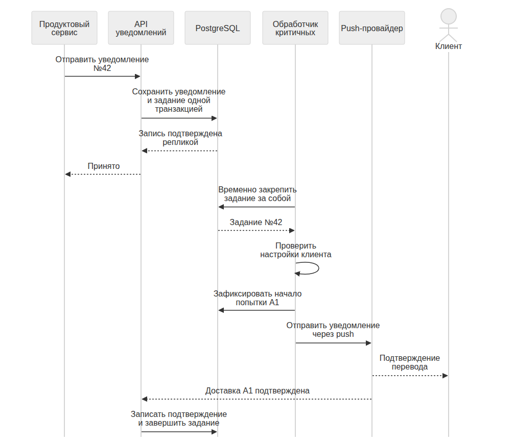
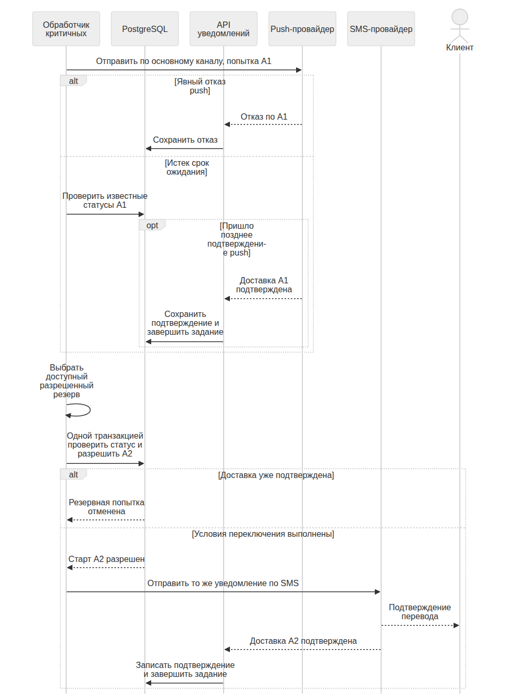

# RFC: Проектирование механизма гарантированной доставки критичных (транзакционных) уведомлений с автоматическим failover между каналами доставки

| Метаданные | Значение |
| --- | --- |
| **Статус** | DONE
| **Автор(ы)** | Иван Барбашин |
| **Ответственный** | Иван Барбашин |
| **Бизнес-заказчик** | онлайн-банк |
| **Ревьюеры** | - |
| **Дата создания** | 17.11.2026 |
| **Дата обновления** | 17.11.2026 |

---

## Оглавление

1. [Контекст](#контекст)
2. [Продуктовый анализ](#продуктовый-анализ)
3. [Пользовательские сценарии](#пользовательские-сценарии)
4. [Статистика](#статистика)
5. [Требования](#требования)
6. [Варианты решения](#варианты-решения)
7. [Сравнительный анализ](#сравнительный-анализ)
8. [Выводы](#выводы)
9. [Связанные задачи](#связанные-задачи)

---

## Контекст

Онлайн-банк переходит на единую платформу уведомлений (Notification Platform). Сейчас продуктовые команды отправляют уведомления из своих сервисов по разным правилам. Из-за этого сообщения иногда задерживаются или дублируются, а команда банка не может централизованно проверить результат доставки.

### Ключевые вопросы

- **Какую проблему мы решаем?** Платформа должна доставлять критичные транзакционные уведомления, например подтверждения переводов и списаний, хотя бы по одному доступному разрешенному каналу. При отказе основного канала она должна автоматически переключаться на резервный из числа push, SMS и email. При выборе канала важны настройки клиента, скорость и стоимость отправки. Если подтверждение от основного канала задержалось, резервная отправка может привести к дублю. Поэтому нужно отслеживать все попытки и их результаты по одному уведомлению.
- **Почему это важно сейчас?** При переходе на общую платформу банк может установить единые правила доставки для всех продуктовых команд. Клиенту важно вовремя узнать о списании или переводе, в том числе чтобы быстрее заметить операцию, которую он не совершал. Критичные уведомления должны приходить быстро и во время массовых рассылок, когда оба потока используют общие ресурсы платформы и каналов. Данный шаг напрямую влияет на бизнес-цель по обеспечению гарантированной доставки критичных уведомлений.
- **Кто затронут этим изменением?** Клиенты банка (получают уведомления об операциях), продуктовые команды (передают запросы на отправку в общую платформу), команда эксплуатации и поддержка (используют историю попыток и статусы доставки, чтобы разбирать сбои, задержки и жалобы).

## Пользовательские сценарии

| Приоритет | Тип сценария | Действующее лицо | Сценарий |
| --- | --- | --- | --- |
| MUST HAVE | Штатная доставка | Клиент банка | После перевода или списания продуктовый сервис передает запрос платформе. Повторный запрос на уже принятое уведомление относится к той же отправке. Клиент получает обязательное уведомление по своему предпочтительному каналу, если тот доступен и разрешен. Платформа дает критичной отправке приоритет даже во время массовой кампании и фиксирует результат после подтверждения доставки. |
| MUST HAVE | Переключение на резервный канал | Клиент банка | Если основной канал подтвердил недоставку или не ответил в срок и выполнены условия переключения, платформа выбирает доступный разрешенный резервный канал с учетом настроек клиента, задержки и стоимости. Если подтверждение приходит до начала резервной отправки, платформа отмечает уведомление как доставленное и отменяет запланированную попытку. |
| SHOULD HAVE | Возобновление доставки после сбоя всех каналов | Клиент банка | Если все разрешенные каналы временно недоступны, уведомление остается в ожидании. Когда хотя бы один канал восстанавливается, платформа автоматически возобновляет доставку. |
| SHOULD HAVE | Оповещение о сбое канала | Сотрудник эксплуатации | Если у канала растет число ошибок доставки или задержек, сотрудник получает оповещение и видит, какой канал затронут. Это позволяет начать разбор сбоя до массового поступления жалоб. |
| COULD HAVE | Подробности доставки в истории | Клиент банка | Клиент открывает уведомление в истории приложения и видит канал и время подтвержденной доставки. |
| COULD HAVE | Отчет о расходах на резервную отправку | Владелец платформы | Владелец платформы просматривает сводку по количеству потраченных денег на резервные отправки за выбранный период. |

**Приоритеты:**

- **MUST HAVE** — обязательно к реализации
- **SHOULD HAVE** — желательно реализовать
- **COULD HAVE** — опционально, при наличии ресурсов

---

## Требования

Требования детализируют доставку критичных транзакционных уведомлений на основе [требований Notification Platform](README.md). Обозначения FR и NFR в таблицах относятся к этому RFC.

### Функциональные требования

| № | Приоритет | Обозначение | Требование |
| --- | --- | --- | --- |
| 1 | MUST HAVE | FR1 | **Прием и штатная доставка.** Платформа подтверждает прием критичного уведомления после его надежного сохранения. Повторный запрос на то же уведомление связывается с существующей отправкой. |
| 2 | MUST HAVE | FR2 | **Переключение и завершение доставки.** При явном отказе основного канала платформа автоматически запускает отправку по доступному разрешенному резервному каналу. При отсутствии подтверждения она сначала проверяет известные статусы попыток и применяет правила переключения по таймауту. Если несколько резервных каналов удовлетворяют настройкам клиента и сроку доставки, выбирается менее дорогой. |
| 3 | SHOULD HAVE | FR3 | **Возобновление после сбоя всех каналов.** Если все разрешенные каналы временно недоступны, платформа сохраняет ожидающее уведомление и автоматически возобновляет доставку после восстановления доступного разрешенного канала. |
| 4 | SHOULD HAVE | FR4 | **Оповещение о сбое канала.** При превышении заданного порога ошибок или задержек платформа уведомляет сотрудника эксплуатации и указывает, какой канал и какой показатель затронуты. |
| 5 | COULD HAVE | FR5 | **Подробности в истории клиента.** Для доставленного уведомления в истории приложения клиент может увидеть канал и время подтвержденной доставки. |
| 6 | COULD HAVE | FR6 | **Отчет о расходах на резервные отправки.** Владелец платформы может посмотреть число резервных SMS, за которые банк заплатил провайдеру, и сумму расходов за выбранный период. |

### Нефункциональные требования

| № | Приоритет | Обозначение | Требование |
| --- | --- | --- | --- |
| 1 | MUST HAVE | NFR1 | **Доставка в штатном режиме и при массовой рассылке.** В штатном режиме за календарный месяц не менее **99%** критичных уведомлений с доступным разрешенным каналом получают подтверждение доставки в течение **2 секунд** с момента приема платформой. Тот же порог проверяется во время кампании на **1 млн получателей** при потоке **300 критичных уведомлений/с** и среднем темпе не менее **600 маркетинговых отправок/с**. |
| 2 | MUST HAVE | NFR2 | **Доставка при отказе основного канала.** При отказе основного канала не менее **99,9%** критичных уведомлений с доступным разрешенным резервным каналом получают подтверждение доставки в течение **10 секунд** с момента приема платформой. |
| 3 | MUST HAVE | NFR3 | **Доступность приема.** Не менее **99,9%** корректных запросов за календарный месяц получают подтверждение приема в пределах таймаута **3 секунды** с момента отправки. |
| 4 | MUST HAVE | NFR4 | **Сохранность при отказе узла.** При отказе одного узла допустимо **0 потерь** критичных уведомлений, прием которых платформа подтвердила, и уже сохраненных подтверждений доставки. |
| 5 | MUST HAVE | NFR5 | **Контроль дублей.** За календарный месяц не более **0,1%** критичных уведомлений с подтвержденной доставкой доставляются повторно по тому же или другому каналу. |
| 6 | MUST HAVE | NFR6 | **Актуальность настроек.** Не менее **99,9%** сохраненных за месяц изменений учитываются во всех новых решениях об отправке в течение **5 секунд** после подтверждения сохранения. |
| 7 | MUST HAVE | NFR7 | **Наблюдаемость доставки.** Как минимум для **99,9%** критичных уведомлений, принятых за календарный месяц, по одному идентификатору доступны записи о приеме, выборе канала, всех начатых попытках отправки и текущем или итоговом статусе. |
| 8 | SHOULD HAVE | NFR8 | **Скорость возобновления доставки.** После минутного сбоя всех каналов при входящем потоке **300 критичных уведомлений/с** платформа возобновляет отправку не менее **99%** накопившихся уведомлений за **2 минуты** с момента восстановления канала. |
| 9 | SHOULD HAVE | NFR9 | **Своевременность оповещения эксплуатации.** Оповещение о сбое приходит в течение **60 секунд** после превышения заданного порога ошибок или задержек. |
| 10 | COULD HAVE | NFR10 | **Точность отчета о расходах.** При сверке за закрытый расчетный период расхождение с данными провайдера по количеству платных резервных SMS и начисленной за них сумме равно **нулю**. |

### Расчет нагрузок

| Тип уведомления | На активного пользователя в день | Уведомлений в сутки | В среднем, уведомлений/с |
| --- | ---: | ---: | ---: |
| Транзакционные | 2 | 3 млн × 2 = **6 млн** | **≈ 69** |
| Сервисные | 3 | 3 млн × 3 = **9 млн** | **≈ 104** |
| Маркетинговые | 5 | 3 млн × 5 = **15 млн** | **≈ 174** |
| Вся платформа | 10 | **30 млн** | **≈ 347** |

---

## Варианты решения

### Вариант 1. Один сервис и PostgreSQL

Сервис сохраняет уведомление в PostgreSQL, подтверждает прием и сам начинает отправку. При отказе основного канала он пробует разрешенный резервный канал. Критичные уведомления и массовые рассылки используют общие обработчики.

#### Штатная доставка

#### Переключение на резервный канал

#### Этапы реализации

| Этап | Описание | Планируемый срок | Ресурсы | Риски |
| --- | --- | --- | --- | --- |
| 1 | Прием и отправка по основному каналу | 1 неделя | Backend | Задержки провайдера |
| 2 | Резервная отправка и проверка отказов | 1 неделя | Backend и QA | Запоздалые подтверждения |

#### Преимущества

- Один сервис и одна база данных упрощают запуск и эксплуатацию.
- Короткий путь от приема до отправки, поскольку сервис сразу обращается к провайдеру.

#### Недостатки

- При падении сервиса незавершенная отправка может зависнуть, хотя запись об уведомлении сохранена.
- Массовая рассылка конкурирует с критичными уведомлениями за обработчики и квоты провайдеров.

---

### Вариант 2. Очередь в PostgreSQL и отдельные обработчики

API одной транзакцией сохраняет уведомление и задание в PostgreSQL с синхронной репликацией, затем подтверждает прием. Обработчики берут задания на ограниченное время, сохраняют результаты попыток и продолжают незавершенную доставку после сбоя. Для критичных отправок выделены отдельный пул и часть квоты провайдера. Настройки клиента кешируются в обработчике.

#### Штатная доставка

#### Переключение на резервный канал

#### Этапы реализации

| Этап | Описание | Планируемый срок | Ресурсы | Риски |
| --- | --- | --- | --- | --- |
| 1 | PostgreSQL HA, очередь заданий и отдельные пулы | 2 недели | Backend и DevOps | Нагрузка на PostgreSQL |
| 2 | Переключение каналов, кеш настроек и испытания | 2 недели | Backend и QA | Дубли и устаревшие настройки |

#### Преимущества

- Другой обработчик продолжает доставку по сохраненному состоянию после сбоя.
- Выделенные обработчики и квоты защищают критичную доставку от нагрузки рассылок.

#### Недостатки

- Нужно реализовать резервирование заданий и согласовать обработку подтверждений с повторными отправками.
- Опрос очереди, синхронная запись и обновление кеша требуют настройки и нагрузочной проверки.

### Соответствие ASR

| ASR | Вариант 1 | Вариант 2 |
| --- | --- | --- |
| ASR1. Доставка под нагрузкой | Общий пул создает риск задержек во время рассылок. | Отдельные пулы и квоты уменьшают конкуренцию за ресурсы. |
| ASR2. Переключение каналов | Сервис переключается при явном отказе, пока процесс работает. | Обработчики подхватывают отказы и таймауты из сохраненного состояния и выбирают разрешенный резерв с учетом срока и стоимости. |
| ASR3. Контроль дублей | Сервис проверяет сохраненный статус. При запоздалом подтверждении возможен дубль. | Идентификаторы уведомления и попыток позволяют отличать повторы. Начало новой попытки и фиксация доставки согласуются одной записью в базе. |
| ASR4. Сохранность и восстановление | Принятое уведомление сохраняется, но автоматического возобновления отправки нет. | Реплицированная очередь сохраняет задания, а обработчики восстанавливают работу после отказа. |
| ASR5. Актуальные настройки | Сервис читает настройки из базы перед отправкой. | При истечении 3 секунд обработчик перечитывает настройки из базы. Порог в 5 секунд проверяется под нагрузкой. |

---

## Сравнительный анализ

### Соответствие требованиям

| Требование | Вариант 1 | Вариант 2 |
| --- | --- | --- |
| FR1. Прием и штатная доставка | Сервис подтверждает прием после записи. Обработка повторного запроса в этом варианте не описана. | API сохраняет уведомление и задание одной транзакцией. Общий идентификатор связывает повторный запрос с существующей отправкой. |
| FR2. Переключение и завершение доставки | Есть переключение при явном отказе. Поведение при таймауте и выбор резерва по стоимости не описаны. |  Обработчик учитывает отказ, таймаут и сохраненные статусы. Среди подходящих по настройкам и сроку резервных каналов выбирается менее дорогой. |
| NFR1. Доставка за 2 секунды |Рассылки и критичные сообщения используют общих обработчиков и общие квоты. | Отдельные пулы и квоты защищают критичный поток. Цель в 99% проверяется в штатном режиме и при совместной нагрузке 300 критичных и 600 маркетинговых отправок в секунду. |
| NFR2. Доставка при отказе за 10 секунд |  Переключение редусмотрено при явном отказе, а ожидание ответа может израсходовать срок доставки. |  Состояние попыток и таймаут позволяют переключиться в пределах общего срока. Цель в 99,9% зависит и от задержки подтверждения по резервному каналу. |
| NFR3. Доступность приема | При остановке единственного экземпляра прием запросов прерывается до его восстановления. | Прием отделен от отправки. Нужно проверить, что не менее 99,9% корректных запросов подтверждаются за 3 секунды, включая периоды переключения базы. |
| NFR4. Сохранность при отказе узла |  Записи переживают остановку приложения, но для самой базы не заложена репликация. | Уведомления, задания и подтверждения доставки сохраняются синхронно на реплике. Нулевые потери проверяются отключением одного узла. |
| NFR5. Доля дублей до 0,1% | Проверка сохраненного статуса помогает при уже известной доставке. Запоздалое подтверждение может прийти после запуска резерва. | Попытки связаны с одним уведомлением, а проверка статуса согласована с запуском следующей попытки. Поздний ответ провайдера после начала резерва все еще может привести к дублю. |
| NFR6. Актуальность настроек за 5 секунд | Сервис читает настройки из PostgreSQL перед отправкой. | Обработчики обновляют локальные копии после истечения 3 секунд. |

---

## Выводы

Рекомендуем **вариант 2 с очередью в PostgreSQL и отдельными обработчиками**. Вариант 1 проще запустить, но при сбое отправка может зависнуть, а во время массовой рассылки критичные сообщения конкурируют с ней за общий пул. Во втором варианте происходит сохранение задание после отказа узла, другой обработчик возобновляет доставку, а выделенные пулы и квоты помогают выдержать срок под нагрузкой.
---

## Приложения

### Глоссарий

| Термин | Определение |
| --- | --- |
| Failover | Автоматическое переключение на резервный канал при отказе основного. |
| Резервирование задания | Временное закрепление задания за обработчиком. После истечения срока его может забрать другой обработчик. |
